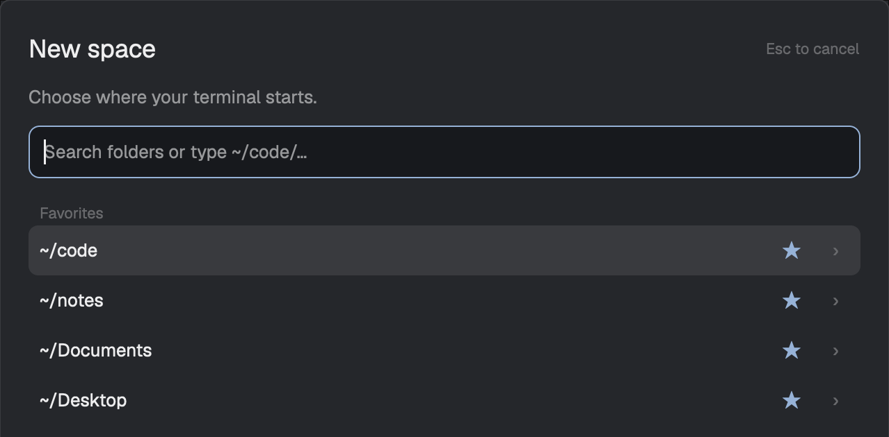

# Space Picker

A native New space dialog that asks where your terminal should start. Search folders, complete paths, and keep favorites and recent choices close at hand. It opens on the user's existing layout through a shortcut or the mod.open command.

## What you see

A centered 640 × 560 dialog using Herdr's current theme. Twenty-pixel padding, 10px gaps, an 18px semibold New space title, a short subtitle, a 38px input, and a scrolling folder list. Favorites, Recent, and Folders have muted 11px headings; searched paths use Matches. Each 36px row has a shortened path, favorite star, and drill-down chevron. Selection uses `selected`, hover uses `hover`. The footer contains a result count, selected keyboard path, search status, Refresh, keyboard hints, Browse…, Cancel, and Open space. Errors use `blocked` color.

## How it behaves

Opening focuses search. Empty search lists saved favorites, recent requests, and home folders, deduplicated. On first use, up to six existing common roots become favorites. Discovery first lists home children, then indexes nested folders under code, hq, hq-os, work, life, notes, Documents, Desktop, favorites, and recents in the background. It caches paths for one minute; Refresh bypasses the cache. Discovery follows symlinks without cycles, skips hidden/dependency folders, defers archive subtrees, and is bounded to 10 levels, 20,000 paths, about 4 MB of names, and four seconds. A limit notice appears when discovery is incomplete. Name search matches case-insensitive tokens, ranks literal matches before omitted-letter matches, and favors leaf prefixes. Fuzzy tokens of at least three characters must fit within one folder segment. Results are capped at 60. Absolute and home-relative paths complete one directory level at a time. Dot directories appear for a dot-prefixed completion. Directory symlinks are included; broken links and files are omitted.

Up/down select; PageUp/PageDown move six rows; the selected path appears below the scrolling list. Tab or › completes the chosen path with a trailing slash. Click a path to create a space there. Enter/Open space tries a typed absolute path first, then the captured highlighted completion if the literal path is absent. A keyboard-selected result takes precedence. Unreadable paths show an error without closing the dialog. Duplicate submissions are blocked during validation. The request's target and overlay are captured before async work.

Stars toggle favorites. Browse… uses the OS folder picker. Cancel/Escape creates no terminal. The last 12 validated requests are saved using the chosen path; canonical identities deduplicate aliases. No agent states are displayed or changed. Remote browsing is outside this version's scope.

## Built from

One mod at `mods/space-picker/`: `main.js`, `paths.js`, `folders.py`, and `mod.json` with place none and overlay width 640/height 560. No layout files are distributed. The mod takes no application-specific props; Herdr supplies its overlay id.

It uses GPUI builders/InputState, `home`, `appHome`, `theme`, `shared`/`setShared`, `exec`, `run`, `pickFolder`, `props`, and `closeOverlay`. Python 3's standard library scans directories through `exec('python3', [helperPath, directory, mode])`, with a five-second scan timeout and a cheap validation mode. No shell, network, or generated art.

Install only the mod folder, check it, then invoke `herdr-app do mod.open '{"name":"space-picker"}'`. The optional `keys.json` assigns cmd-n to mod.open:space-picker. Merge only that binding, with the user's agreement to replace their existing New space shortcut, or choose another key. The default installation requires no copied sidebar, tab bar, floating launcher, or custom layout. If the user explicitly wants clickable + integration, follow docs/plus-button.md to create a personal layout and Spaces sidebar copy; do not create these for shortcut-only users. Built-in + buttons keep Herdr's default behavior.

## Watch out

This targets the desktop app, not the legacy TUI plugin system. Tested on macOS app 0.1.9. Python 3 must be in the app's PATH. POSIX paths only; Windows and remote browsing are not implemented. Native fs/promises in 0.1.9 is home-scoped and does not classify directory symlinks as directories, so the Python bridge remains necessary for the supported behavior.

Keep dot segments until the OS resolves them; lexical parent traversal changes symlink semantics. Ignore stale asynchronous completion results. Never interpolate paths into shell commands. Do not ship shared user data. `run()` returns null, so recents represent requests rather than confirmed terminal startup.

The helper is located at appHome() + '/mods/space-picker/folders.py'; rename that path too if the mod name changes. Use the ordinary native scrollbar. VirtualListScrollHandle.new() panics in the 0.1.9 checker; the selected keyboard path is echoed in the footer because programmatic scrolling is unavailable. Do not add floating controls or clone Herdr UI as part of the default installation. Personal + integration is optional and must be chosen explicitly. The proposed inline sidebar integration is research, not an existing API; see docs/integration.md.

## Done when

- `npm test` and the installed mod's `herdr-app check` pass.
- The direct command and optional shortcut open the picker on the original layout.
- Name search and partial-path Tab completion find a known project.
- Enter requests a space in the chosen folder, including names containing spaces.
- Directory symlinks and dot-prefixed completion work.
- Scrolling reveals further rows; keyboard selection is echoed in the footer.
- A nonexistent path with no completion shows an error without creating a space.
- Favorite and recent changes survive reopening; Cancel/Escape creates no space.
